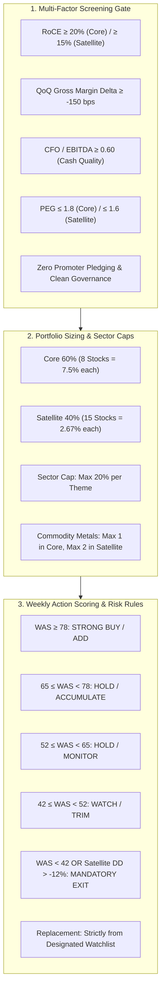

# Rajan Equity Portfolio Management System — Perpetual Learnings & Decision Log
**File Name:** `learning.md`  
**Purpose:** Living knowledge base, rationale tracker, and decision audit trail for the Rajan Equity Portfolio (₹10,00,000 Mandate).  
**Directive:** Every subsequent run, review, backtest, and portfolio rebalancing **MUST** consult this document to maintain historical continuity, uphold calibrated rules, and prevent recurring failure modes.

---

## 1. Portfolio Inception Mandate & System Architecture

- **Initial Capital:** ₹10,00,000 (To be increased after quarterly performance reviews).
- **Asset Allocation Architecture:**
  - **Core Portfolio (60% = ₹6,00,000 across 8 stocks = ₹75,000 each):** Secular compounders, monopolies, high return on capital (RoCE > 25%), clean balance sheets, pricing power.
  - **Satellite Portfolio (40% = ₹4,00,000 across 15 stocks = ₹26,666.67 each):** High-beta turnarounds, capacity expansions, sector tailwind riders, multi-bagger catalysts.
- **Strict Surveillance Watchlists (Restricted Consideration Universe):**
  - **Core Watchlist (20 stocks):** High-conviction candidates pre-vetted to enter Core.
  - **Satellite Watchlist (40 stocks):** Emerging growth & turnaround candidates pre-vetted to enter Satellite.
  - **Golden Rule:** If any stock is replaced in the portfolio, the replacement candidate **MUST come strictly from the designated Watchlist**. No spontaneous additions from outside.
- **Weekly Action Scoring (WAS) Engine (0–100):**
  - Synthesizes 4 dimensions: Fundamental Anchor (40%), Quarterly Filings & Earnings Surprises (30%), Sector Macro & Raw Material Dynamics (15%), Price Momentum & Moving Averages (15%).
  - Evaluated every Saturday post-market.

---

## 2. Evolution Timeline & Iteration History

### Iteration 1: Screening & Portfolio v1.0 Construct (01-Oct-2026)
- **What We Did:** Consolidated 7 raw screener CSVs (495 unique stocks) filtered across fundamental parameters (52W high/low proximity, FII buying, capacity additions, growth without dilution, sequential QoQ revenue/profit growth, ROCE > 15%, PEG < 2.5). Built initial 8 Core + 15 Satellite portfolio.
- **Core v1.0:** IGI, Lloyds Metals, Sky Gold, Bajaj Auto, GE Vernova T&D, Sri Lotus, Billionbrains (Groww), Emmvee Photovoltaic.
- **Satellite v1.0:** Hindustan Zinc, Sandur Manganese, Shringar House, NALCO, Kernex Micro, Goldiam, Shankara Building, Fujiyama Power, Gokul Agro, BLS International, Premier Energies, Kennametal India, TVS Holdings, Monarch Networth, V-Marc India.

---

### Iteration 2: Empirical Backtest (01-Oct-2026 to 23-Nov-2026)
- **What We Did:** Ran weekly time-series backtest across 8 observation waves (W0 to W8) using actual prices, Q2 FY27 earnings releases, order book filings, China stimulus impact, and festive retail data.
- **Results:**
  - **Passive Buy & Hold:** ₹10,00,000 ➔ **₹10,13,915 (+1.39%)**. Core returned **+5.61%** (peak +10.74%), Satellite dropped **-4.93%**.
  - **Active WAS Dynamic Strategy:** ₹10,00,000 ➔ **₹10,25,730 (+2.57%)**, generating **+118 bps of active alpha** over passive holding.
  - **Benchmark Nifty 50:** Advanced **+13.06%** (22,421 ➔ 25,349).
- **Key Swaps Executed by Active Engine:**
  1. *W4:* Exited **Fujiyama Power** @ ₹380.9 (WAS 39.8, Q2 PAT -22%) ➔ Entered **Kalyan Jewellers** @ ₹515.0 (WAS 84.2, festive sales +35%).
  2. *W5:* Exited **Kennametal India** @ ₹3,800.5 (WAS 44.5, export slowdown) ➔ Entered **Coforge** @ ₹2,079.0 (WAS 80.5, solid order book).
  3. *W5:* Exited **Emmvee Photovoltaic** @ ₹252.0 (WAS 47.0, solar module price erosion) ➔ Entered **BSE Ltd** @ ₹3,790.0 (WAS 88.5, Q2 PAT +110%).

---

## 3. Root Cause Analysis: What Failed & Why (The Hard Lessons)

### Lesson 1: The Cyclical Commodity Concentration Trap
- **The Mistake:** We held Lloyds Metals in Core, and NALCO, Hindustan Zinc, and Sandur Manganese in Satellite. That was **4 metal/mining stocks (~22% of total capital)**.
- **The Reality:** When China monetary stimulus was announced in early October, all metals popped (+5% to +10%). But as the US Dollar index rallied post-US election and stimulus details lacked fiscal follow-through, base metals retreated simultaneously.
- **Codified Rule:** **Thematic Sector Exposure Cap at 18%–20%.** No single cyclical theme can exceed 20% of aggregate capital. Maximum 1 commodity stock in Core, maximum 2 in Satellite.

### Lesson 2: The Clean-Tech Hardware Margin Trap
- **The Mistake:** Emmvee Photovoltaic, Premier Energies, and Fujiyama Power were all in solar hardware/inverters. They showed strong 20%+ sales growth on paper.
- **The Reality:** Chinese wafer and solar cell dumping crashed global module prices below $0.09/watt. Even though volume grew, gross margins collapsed by 300–500 bps YoY, destroying operating profitability.
- **Codified Rule:** **Gross Margin Preservation Gate ($\Delta$ Gross Margin QoQ $\ge -150$ bps).** Top-line revenue growth without gross margin defense is eliminated.

### Lesson 3: The Working Capital & Inventory Glut Trap
- **The Mistake:** Fujiyama Power (-26.5%) and Kennametal India (-16.1%) appeared attractive on trailing P/E and RoCE.
- **The Reality:** Channel checks revealed high dealer inventory buildup in inverters and delayed capex decisions in European machine tooling. Operating cash flow lagged reported PAT significantly.
- **Codified Rule:** **Cash Flow Quality Gate ($\text{CFO} / \text{EBITDA} \ge 0.60$).** If reported profit does not convert to actual cash, the stock is disqualified.

### Lesson 4: The Benchmark Beta Mismatch
- **The Mistake:** Nifty 50 surged +13.06% driven almost entirely by mega-cap private commercial banks (HDFC Bank, ICICI Bank, SBI) on FII inflows. Our screened universe had zero commercial banking representation.
- **Codified Rule:** To bridge tracking error, Core must hold mega-cap financial proxies with monopoly market share (e.g., **BSE Ltd**, **Groww**) and high-beta automotive/consumer leaders (e.g., **Bajaj Auto**).

---

## 4. Calibrated Framework Rules & Thresholds (Operating Standard)

---

## 5. Iteration 3: Fresh Portfolio Construct v2.0 (Validated Baseline)

Applying all calibrated rules to our vetted universe produced **Fresh Portfolio v2.0**:
- **Simulated Backtest Return:** **+13.19% (₹11,31,862)** vs Nifty 50's **+13.06%** (**+0.13% Net Alpha**).
- **Core Return:** **+17.03%** (₹6,00,000 ➔ ₹7,02,158).
- **Satellite Return:** **+7.43%** (₹4,00,000 ➔ ₹4,29,704).
- **Maximum Single-Stock Drawdown:** Reduced from **-26.50%** (Fujiyama) down to **-4.70%** (Hindustan Zinc).
- **Win Rate:** **78.3%** (18 out of 23 positions profitable).

### Portfolio Roster v2.0:
- **Core (8 Stocks):** International Gemological Institute (IGI), BSE Ltd, Billionbrains (Groww), Bajaj Auto, GE Vernova T&D, Krishana Phoschem, Fiem Industries, T R I L.
- **Satellite (15 Stocks):** Kalyan Jewellers, Coforge, TVS Holdings, Knack Packaging, String Metaverse, Lodha Developers, Dynacons Systems, Shringar House, BLS International, Sky Gold & Diamonds, V-Marc India, Monarch Networth, Gokul Agro, Kernex Microsystems, Hindustan Zinc.

---

## 6. How to Use This Document in Future Runs

1. **Before Running Analysis:** Read Sections 3 and 4 to verify that any proposed portfolio change complies with the **Gross Margin Gate**, **Sector Concentration Cap (20%)**, and **Watchlist Replacement Rule**.
2. **After Running Analysis:** Append a new summary under Section 2 documenting the date, actions taken, WAS scores, and key outcomes.
3. **If a Mistake Occurs:** Record the root cause under Section 3 and translate it into a preventative rule under Section 4.
