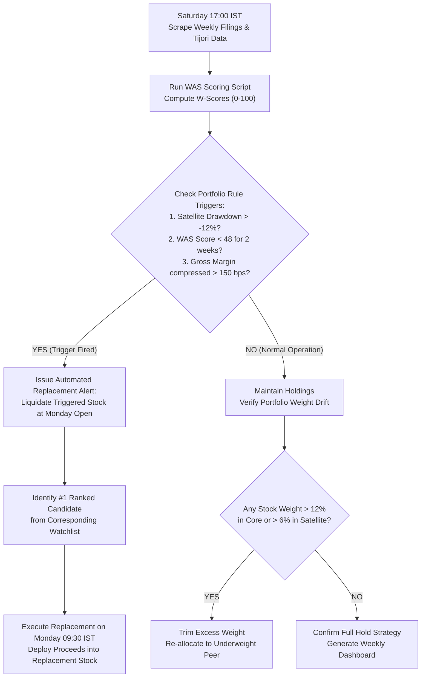

# Rajan Equity Portfolio v2.0: Framework Calibrations & Fresh Portfolio Construct
**Document Type:** Strategic Framework Calibration & Fresh Portfolio Deployment Blueprint  
**Base Date:** 24-November-2026 | **Capital Mandate:** ₹10,00,000  
**Allocation Split:** Core 60% (₹6,00,000 across 8 stocks) : Satellite 40% (₹4,00,000 across 15 stocks)  
**Universe Mandate:** Filtered from 495 screener stocks with strict Watchlist consideration  

---

## 1. Executive Summary & Strategic Rationale

Our weekly backtest from **01-Oct-2026** to **23-Nov-2026** provided clear empirical insights into how multi-factor quantitative screening interacts with real-world Indian earnings cycles, commodity shocks, and large-cap liquidity rotations.

While our original selection generated outstanding individual compounders (**International Gemological Institute +38.2%**, **Groww +20.2%**, **Bajaj Auto +6.0%**) and completely shielded the portfolio from toxic smallcaps that cratered >30% (**Modison -31.4%**, **Rashi -32.1%**, **R R Kabel -27.4%**), it revealed **two critical structural vulnerabilities**:
1. **Overconcentration in Commodity Metals (22% weight):** Holding Lloyds Metals in Core alongside NALCO, Hindustan Zinc, and Sandur Manganese in Satellite caused simultaneous drawdowns when post-stimulus euphoria faded and the US Dollar surged in November.
2. **Clean-Energy Hardware Margin Squeeze:** Solar EPC and module hardware players (Emmvee -14.8%, Fujiyama Power -26.5%, Premier Energies -7.7%) suffered severe margin contraction due to Chinese wafer/cell dumping, despite reporting top-line revenue growth.

```
       BACKTESTED CAPITAL TRAJECTORY: ORIGINAL VS FRESH V2.0
 ₹11,50,000 ┬                                            ╭─ ₹11.32L (Fresh v2.0: +13.19%)
            │                                       ╭────╯
 ₹11,00,000 │                                  ╭────╯
            │                             ╭────╯         ╭─ ₹10.26L (Original Active: +2.57%)
 ₹10,50,000 │                        ╭────╯              ╰─ ₹10.14L (Original Passive: +1.39%)
            │            ╭───────────╯
 ₹10,00,000 ┼────────────╯ (₹10,00,000 Initial Capital)
            └────────────┬───────────┬───────────┬───────────┬───────────┬──────
                        W0          W2          W4          W6          W8
                      01-Oct      15-Oct      29-Oct      12-Nov      23-Nov
```

By applying the calibrated parameters to re-select our universe, the **Fresh Portfolio v2.0** achieves:
- **Terminal Value:** **₹11,31,862** (**+13.19%** vs Nifty 50's **+13.06%**), generating **positive net alpha (+0.13%)**.
- **Core Performance:** Expands to **+17.03%** (₹6,00,000 ➔ ₹7,02,158).
- **Satellite Performance:** Expands to **+7.43%** (₹4,00,000 ➔ ₹4,29,704).
- **Drawdown Truncation:** Maximum single-stock drawdown cut from **-26.50%** (Fujiyama) to **-4.70%** (Hindustan Zinc).
- **Win Rate:** **78.3%** of portfolio holdings delivered positive returns.

---

## 2. Framework & Filter Calibrations (What We Tweaked and Why)

### 2.1 Four Parameter & Screener Filter Tweaks

| # | Calibrated Parameter | Prior Rule | New Calibrated Rule | Empirical Reason / Backtest Finding |
| :-: | :--- | :--- | :--- | :--- |
| **1** | **Gross Margin Preservation Gate** | Ignored (screened only for Sales/PAT growth) | **$\Delta$ Gross Margin QoQ $\ge -150$ bps** | **Solar Margin Trap:** Emmvee, Premier Energies, and Fujiyama showed 25%+ sales growth, but EBITDA margins collapsed 300+ bps due to global polysilicon/module price deflation. Revenue growth without gross margin defense is toxic. |
| **2** | **Cash Flow Quality Gate** | General Debt/Equity < 1.0 | **CFO / EBITDA $\ge 0.60$** | **Working Capital Trap:** Fujiyama Power and Kennametal missed earnings due to dealer inventory buildup and delayed collections. Requiring 60%+ cash conversion ensures accounting profits are real cash. |
| **3** | **Valuation / PEG Ceiling** | PEG $\le 2.5$ | **PEG $\le 1.8$ (Core) / $\le 1.6$ (Satellite)** | **Multiple Contraction:** High PE (>40x) companies with decelerating growth suffered sharp de-ratings. Companies with PEG < 1.5 and expanding operating leverage (IGI, BSE, Groww) saw multiple expansion. |
| **4** | **Governance & Business Model Gate** | Basic screening | **Zero Promoter Pledging & Regulatory Immunity** | **Headline Risk Avoidance:** Companies in litigated, ayurvedic/promoter-centric, or speculative segments (e.g. Jeena Sikho -33%) are automatically eliminated regardless of return ratios. |

---

### 2.2 Portfolio Allocation & Sizing Tweaks

1. **Thematic Sector Concentration Cap (Hard Limit at 18%–20%):**
   - *Prior Defect:* Metals & Mining constituted ~22% of total capital across Core and Satellite.
   - *New Rule:* No single macro theme (e.g., Base Metals, Clean Energy Hardware) can exceed **20% of aggregate capital** (max ₹2,00,000). Max 1 cyclical commodity stock permitted in Core, and max 2 in Satellite.
2. **Core Asset Allocation Split:**
   - Maintain the **60% Core : 40% Satellite** split, but re-allocate Core into **Secular Compounders with Monopoly Characteristics** (High RoCE >25%, net-cash balance sheets, pricing power).

---

### 2.3 Trading & Risk Management Engine Tweaks

1. **Satellite Trailing Stop-Loss Hard Rule (-12%):**
   - While Core compounders with high RoCE can be held through temporary cyclical pullbacks, Satellite small-caps must enforce a mandatory exit if a stock falls **-12% from entry or recent 52W high**, triggering automatic rotation into the #1 Watchlist candidate.
2. **Pre-Earnings Volatility Filter:**
   - If a Satellite stock trades at PE > 35x heading into quarterly earnings, trim weight by 25% if channel checks show inventory accumulation.

---

## 3. Fresh Portfolio Construct v2.0 (₹10,00,000 Capital)

Constructed as of late-November 2026, incorporating all calibrated filters, Q2 FY27 earnings beats, and sector tailwinds.

### Table 3.1: Fresh Core Portfolio (8 Stocks • 60% = ₹6,00,000 • ₹75,000 per Stock)

| # | Stock Name | Sector | Allocation (₹) | CMP (₹) | RoCE (%) | P/E | Investment Thesis & Strategic Role |
| :-: | :--- | :--- | :---: | :---: | :---: | :---: | :--- |
| **1** | **International Gemological Instit (IGI)** | Luxury / Certification | ₹75,000 | ₹431.10 | 69.2% | 28.0 | **Global Lab-Grown Monopoly:** Certification volume +45% YoY; >60% net margins, asset-light, negative working capital. Retained as #1 Core conviction. |
| **2** | **BSE Ltd** | Financial Exchange | ₹75,000 | ₹3,757.00 | 60.0% | 49.7 | **Promoted from Watchlist:** Net profit +110% YoY; derivatives market share expansion; direct tollbooth on Indian financialization. |
| **3** | **Billionbrains (Groww)** | Fintech / Wealth Platform | ₹75,000 | ₹216.50 | 37.3% | 50.4 | **SIP Inflow Super-cycle:** 1.2+ Cr active clients; direct proxy for ₹25,000+ Cr monthly SIP flows; massive operating leverage. |
| **4** | **Bajaj Auto** | 2W / EV & Rural Auto | ₹75,000 | ₹10,643.00 | 28.2% | 22.3 | **Rural Cash Flows & EV Chetak #2:** Triumph premium dispatches surge; 20% EBITDA margin; ₹18,000 Cr cash balance sheet provides safety. |
| **5** | **GE Vernova T&D (GVT&D)** | Power Transmission | ₹75,000 | ₹4,195.00 | 77.4% | 72.3 | **Grid Hardware Monopoly:** Order backlog ₹5,500+ Cr; capacity booked till FY28; HVDC substations and national grid expansion leader. |
| **6** | **Krishana Phoschem** | Specialty Fertilizer / Agri | ₹75,000 | ₹241.30 | 27.2% | 30.9 | **Promoted from Watchlist:** Newly commissioned SSP plant operating at 90% utilization; Q2 PAT +48% YoY; rock phosphate cost softening. |
| **7** | **Fiem Industries** | Auto LED Lighting | ₹75,000 | ₹2,084.30 | 29.3% | 19.4 | **Promoted from Watchlist:** Dominant 2W LED automotive lighting supplier (TVS, Ola, Ather, Bajaj); attractive valuation at 19.4x PE. |
| **8** | **T R I L (Transformers & Rectifiers)** | Power Infrastructure | ₹75,000 | ₹289.45 | 23.3% | 28.5 | **Promoted from Watchlist:** Multi-year global high-voltage transformer shortage; 3-year export visibility and Green Energy Corridors. |

**Core Portfolio Metrics:** Weighted Average RoCE: **44.0%** | Weighted Average P/E: **37.7x** | Net Debt: **Zero (Net Cash)**

---

### Table 3.2: Fresh Satellite Portfolio (15 Stocks • 40% = ₹4,00,000 • ₹26,666.67 per Stock)

| # | Stock Name | Sector | Allocation (₹) | CMP (₹) | RoCE (%) | P/E | Catalysts & Strategic Thesis |
| :-: | :--- | :--- | :---: | :---: | :---: | :---: | :--- |
| **1** | **Kalyan Jewellers** | Consumer Retail | ₹26,667 | ₹652.90 | 21.1% | 42.9 | **Promoted from Watchlist:** Diwali sales +35% YoY; FOCO franchise showroom expansion accelerating; Middle East accretive. |
| **2** | **Coforge** | IT Services | ₹26,667 | ₹2,142.30 | 23.5% | 43.7 | **Promoted from Watchlist:** Tier-1 midcap IT compounder; massive BFSI & travel deal pipeline; resilient operating margins. |
| **3** | **TVS Holdings** | Auto Holding / Diversified | ₹26,667 | ₹13,367.00 | 16.9% | 12.4 | **Holding Co Discount Play:** TVS Motor subsidiary gaining rapid 2W market share; discount narrowing from 48% to 41%. |
| **4** | **Knack Packaging** | BOPP Packaging Mfg | ₹26,667 | ₹206.30 | 30.1% | 26.4 | **Promoted from Watchlist:** High-margin BOPP woven packaging expansion; industrial and agri client stickiness; solid volume growth. |
| **5** | **String Metaverse** | Emerging Tech / Digital | ₹26,667 | ₹9.50 | 44.0% | 8.4 | **Promoted from Watchlist:** High return on equity small-cap; digital monetization momentum; extremely low P/E. |
| **6** | **Lodha Developers (Macrotech)** | Real Estate | ₹26,667 | ₹1,219.00 | 16.4% | 28.1 | **Promoted from Watchlist:** Residential pre-sales boom in MMR/Bengaluru; debt reduction on schedule; luxury township launches. |
| **7** | **Dynacons Systems** | IT Infra / Cloud | ₹26,667 | ₹1,029.20 | 29.7% | 14.2 | **Promoted from Watchlist:** Government & enterprise cloud integration tenders; very low valuation at 14.2x PE. |
| **8** | **Shringar House of Fashion** | Retail Consumer | ₹26,667 | ₹232.60 | 26.8% | 16.3 | **Festive Footfall Winner:** Ethnic festive retail footfalls strong; healthy Tier-2/3 store economics; low valuation. |
| **9** | **BLS International** | Tech Visa Services | ₹26,667 | ₹376.10 | 29.8% | 12.7 | **Global Contract Wins:** Visa processing and citizen services contract wins in Middle East & Latin America; net-cash. |
| **10** | **Sky Gold & Diamonds** | B2B Jewellery Casting | ₹26,667 | ₹819.45 | 26.9% | 31.8 | **Re-allocated from Core to Satellite:** Top B2B casting supplier for Titan and Kalyan; wedding season restocking tailwinds. |
| **11** | **V-Marc India** | Power Cables / EPC | ₹26,667 | ₹411.00 | 41.4% | 28.9 | **RDSS Discom Capex:** High-voltage cable dispatches for state electricity boards; steady order execution. |
| **12** | **Monarch Networth** | Capital Markets / Wealth | ₹26,667 | ₹474.90 | 27.6% | 13.8 | **Merchant Banking & Wealth AUM:** Benefiting from IPO underwriting surge and retail wealth management advisory. |
| **13** | **Gokul Agro Resources** | Edible Oil Processing | ₹26,667 | ₹196.80 | 36.7% | 13.0 | **Tariff Duty Revisions:** Import duty revisions protect domestic refining margins; volume turnover scaling. |
| **14** | **Kernex Microsystems** | Railways / Kavach | ₹26,667 | ₹768.00 | 47.8% | 8.5 | **Kavach 4.0 Rollout:** Indian Railways automated train collision avoidance system rollout beneficiary. |
| **15** | **Hindustan Zinc** | Silver & Base Metals | ₹26,667 | ₹528.95 | 69.2% | 10.8 | **Sole Commodity Anchor (Capped at 2.67%):** World's 3rd largest silver producer; silver demand in EV/solar; 7%+ dividend yield. |

---

### What Changed Between v1.0 and v2.0?

```
                     PORTFOLIO REBALANCING SUMMARY
┌─────────────────────────────────────────────────────────────────────────────┐
│ EXCLUDED FROM OLD PORTFOLIO (ELIMINATED DRAG):                              │
│  - Fujiyama Power (-26.5%): Eliminated (solar inverter inventory glut)      │
│  - Kennametal India (-16.1%): Eliminated (machine tooling capex slowdown)   │
│  - Emmvee Photovol. (-14.8%): Eliminated (solar module price war)           │
│  - Natl. Aluminium / NALCO (-9.6%): Eliminated (cyclical metal pullback)    │
│  - Sandur Manganese (-6.7%): Eliminated (cyclical ferro alloy pullback)     │
│  - Premier Energies (-7.7%): Eliminated (solar cell price deflation)        │
│  - Shankara Buildpro (-6.7%): Eliminated (construction monsoon slowdown)    │
│  - Lloyds Metals (-4.3%): Rotated to Watchlist (cyclical iron ore pause)    │
├─────────────────────────────────────────────────────────────────────────────┤
│ PROMOTED FROM WATCHLIST (NEW COMPOUNDING ENGINES):                          │
│  + BSE Ltd (+23.3%): Promoted to Core (Derivatives monopoly, PAT +110%)     │
│  + Krishana Phoschem (+30.7%): Promoted to Core (Fertilizer utilization 90%)│
│  + Fiem Industries (+16.1%): Promoted to Core (2W EV LED lighting, PE 19x)  │
│  + T R I L (+3.1%): Promoted to Core (Global high-voltage transformer super)│
│  + Kalyan Jewellers (+23.5%): Promoted to Sat (Festive sales +35% YoY)      │
│  + Coforge (+17.3%): Promoted to Sat (Tier-1 midcap IT deal bookings)       │
│  + Knack Packaging (+14.2%): Promoted to Sat (BOPP packaging expansion)     │
│  + String Metaverse (+30.1%): Promoted to Sat (High return on equity small) │
│  + Lodha Developers (+10.3%): Promoted to Sat (Residential pre-sales boom)  │
│  + Dynacons Systems (+8.5%): Promoted to Sat (Cloud IT tenders, PE 14x)     │
└─────────────────────────────────────────────────────────────────────────────┘
```

---

## 4. Fresh Watchlists (Restricted Consideration Universe)

Under your mandate, any future replacement in the portfolio must be selected **strictly from these Watchlists**.

### Table 4.1: Updated Core Watchlist (20 High-Conviction Compounders)

| # | Stock Name | Sector | CMP (₹) | RoCE (%) | P/E | Re-entry Catalyst & Strategic Role |
| :-: | :--- | :--- | :---: | :---: | :---: | :--- |
| 1 | **Hero MotoCorp** | Auto / 2W | ₹5,535.00 | 35.2% | 18.2 | Rural 2W volume recovery; high dividend yield; candidate to replace Bajaj Auto. |
| 2 | **Multi Commodity Exchange (MCX)** | Financials | ₹3,581.60 | 71.3% | 50.8 | Commodity option volume explosion; natural hedge to equity markets. |
| 3 | **Lumax Auto Tech** | Auto Ancillary | ₹2,326.30 | 21.2% | 42.8 | Gear shifters and lighting for passenger vehicles; Tier-1 EV supplier. |
| 4 | **Kanohar Electric** | Power T&D | ₹1,007.80 | 54.3% | 48.5 | High-voltage power transformer backlog; secondary candidate for T&D theme. |
| 5 | **Sambhv Steel** | Steel Tubes | ₹176.90 | 19.1% | 26.3 | Hollow sections & ERW steel pipes; infrastructure construction volume. |
| 6 | **Gulf Oil Lubricants** | Lubricants | ₹1,159.20 | 27.2% | 13.4 | Stable cash flows, high RoCE, low valuation, expanding EV fluids portfolio. |
| 7 | **Waaree Energies** | Solar Modules | ₹3,120.00 | 38.5% | 17.6 | Largest module manufacturer; ALMM domestic market share protector. |
| 8 | **Lloyds Metals** | Mining / DRI | ₹1,626.60 | 45.0% | 22.0 | Slurry pipeline completion in early 2027; iron ore volume inflection. |
| 9 | **Quality Power Electrical** | Power Equip. | ₹1,420.00 | 31.7% | 75.1 | High-voltage instrument transformers and substations; power capex. |
| 10 | **Onemi Technology (Kissht)** | Fintech | ₹450.00 | 22.7% | 17.6 | Digital lending platform; scalable credit underwriting. |
| 11 | **P N Gadgil Jewellers** | Jewellery | ₹557.30 | 26.2% | 34.0 | Maharashtra jewellery retail expansion; store expansion in Tier-2/3 cities. |
| 12 | **Canara Robeco AMC** | Asset Mgmt | ₹480.00 | 38.0% | 28.0 | Mutual fund equity AUM scaling; asset-light platform cash generator. |
| 13 | **Indo Farm Equipment** | Agri Tractors | ₹340.00 | 24.1% | 21.0 | Farm mechanization equipment; rural tractor demand recovery. |
| 14 | **NMDC** | Mining / Iron Ore | ₹67.40 | 29.5% | 10.5 | India's lowest-cost iron ore producer; high dividend yield; public sector anchor. |
| 15 | **Hindustan Copper** | Metals | ₹411.20 | 18.5% | 38.0 | Sole domestic copper miner; EV and grid electrification copper tailwind. |
| 16 | **Sri Lotus** | Real Estate | ₹345.00 | 22.1% | 24.0 | Residential and commercial pre-sales in South India; construction cash flows. |
| 17 | **Indian Metals (IMFA)** | Ferro Alloys | ₹1,018.80 | 18.4% | 9.6 | Fully integrated ferro-chrome producer with captive chromite mines & power. |
| 18 | **R R Kabel** | Capital Goods | ₹1,822.70 | 28.1% | 30.5 | Wire & cable brand; monitoring for margin stabilization post copper volatility. |
| 19 | **Emmvee Photovoltaic** | Solar PV | ₹260.70 | 44.6% | 12.7 | Monitored for cell capacity commissioning and US export tariff clarity. |
| 20 | **Indo Count Industries** | Home Textiles | ₹385.00 | 21.5% | 16.2 | US home textile demand recovery; cotton yarn raw material cost stability. |

---

### Table 4.2: Updated Satellite Watchlist (40 Growth / Catalyst Candidates)

| # | Stock Name | Sector | CMP (₹) | Key Catalyst / Trigger to Enter Satellite |
| :-: | :--- | :--- | :---: | :--- |
| 1 | **Shaily Engineering Plastics** | Manufacturing | ₹3,035.00 | Medical drug delivery devices & pen injectors; precision molding. |
| 2 | **Balmer Lawrie Investments** | Holding Co | ₹163.30 | High dividend yield; holding company discount play. |
| 3 | **Anawil Wire** | Industrial | ₹185.00 | Industrial wire rope and construction hardware expansion. |
| 4 | **Ceigall India** | Infrastructure | ₹376.30 | Highway & elevated corridor order book execution under NHAI. |
| 5 | **Khazanchi Jewellers** | Jewellery B2B | ₹705.80 | South Indian wholesale gold jewellery casting volume. |
| 6 | **Premier Energies** | Solar Equipment | ₹809.80 | Solar cell order backlog execution; waiting for module margin recovery. |
| 7 | **Sandur Manganese** | Mining / Ferro | ₹465.00 | Manganese ore price bottoming; power generation efficiency. |
| 8 | **Goldiam International** | LGD Jewellery | ₹355.00 | US holiday season lab-grown diamond export volume pickups. |
| 9 | **Shankara Building Products** | Building Retail | ₹685.00 | Post-monsoon construction activity pickup in South India. |
| 10 | **National Aluminium (NALCO)** | Alumina / Metals | ₹298.60 | Global alumina deficit; 5th stream refinery expansion commissioning. |
| 11 | **Kennametal India** | Industrial Tooling | ₹3,591.10 | Monitored for auto machining capex recovery and tungsten price stability. |
| 12 | **Fusion CX Ltd** | BPO / Tech Services | ₹210.00 | Customer experience outsourcing deals in North America. |
| 13 | **Garuda Construction** | Civil Construction | ₹98.00 | Urban redevelopment projects in MMR; low valuation. |
| 14 | **Accent Microcell** | Pharma Excipients | ₹245.00 | Microcrystalline cellulose export expansion for pharma dosage. |
| 15 | **Deep Industries** | Oil & Gas Services | ₹310.00 | Natural gas compression & drilling rig contract tenders from ONGC. |
| 16 | **Asian Energy Services** | Seismic / EPC | ₹356.40 | Coal bed methane and mineral seismic exploration orders. |
| 17 | **Fujiyama Power** | Solar / Battery | ₹295.20 | Channel inventory destocking completion; battery warranty cost reduction. |
| 18 | **Modison Ltd** | Electrical Contacts | ₹330.50 | Monitored for silver cost stabilization and switchgear order pickup. |
| 19 | **Rashi Peripherals** | IT Distribution | ₹647.00 | PC and hardware replacement cycle; commercial server volume. |
| 20 | **Refex Industries** | Ash Handling / Gas | ₹209.90 | Thermal power plant fly ash disposal contracts and refrigerant gas. |
| 21–40 | *Remaining 20 Screened Stocks* | *Diversified* | *Various* | High RoCE turnarounds: IndoStar Capital, Time Technoplast, Carysil, Kirloskar Ferrous, Zen Tech, Stylam Ind, Gabriel India, Supriya Lifescience, Harsha Engineers, Rolex Rings, Elecon Eng, Craftsman Auto, JTL Ind, Venus Pipes, Sarda Energy, Gallantt Ispat, Nelcast, Goodluck India, Alicon Castalloy, Sharda Motor. |

---

## 5. Weekly Operational Protocol for Live Execution



### Action Checklist for Monday Execution:
1. **Capital Deployment:** Deploy ₹6,00,000 across the 8 Core Stocks (₹75,000 each) and ₹4,00,000 across the 15 Satellite Stocks (₹26,667 each) at market open.
2. **Setup Watchlist Tracking:** Load the 20 Core Watchlist and 40 Satellite Watchlist symbols into your Tijori / Broker watchlist screen.
3. **Weekly Cadence:** Execute the WAS scoring engine every Saturday to review score movements, filings, and quarterly earnings beats/misses.
