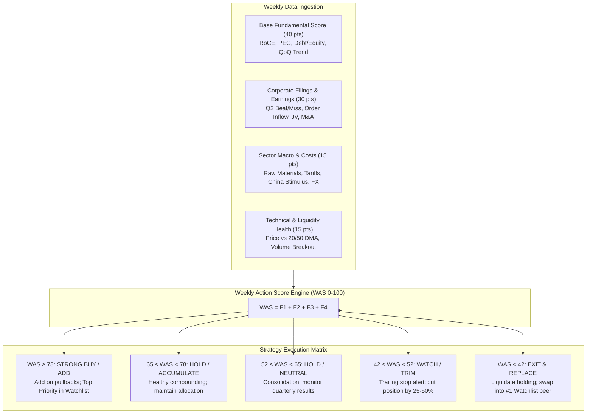
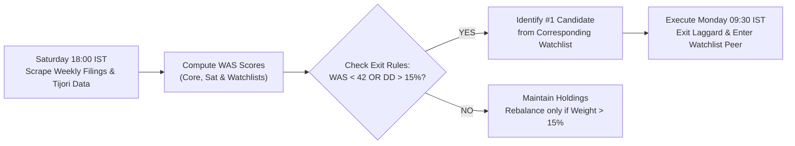

# Rajan Equity Portfolio: Weekly Backtest & Model Validation Report
**Evaluation Period:** 01-October-2026 to 23-November-2026 (8 Weekly Observation Intervals)  
**Initial Capital Mandate:** ₹10,00,000 (Core 60% = ₹6,00,000 across 8 stocks; Satellite 40% = ₹4,00,000 across 15 stocks)  
**Benchmark:** Nifty 50 (`^NSEI`) | **Evaluation Mode:** Weekly Action Score (WAS) Multi-Factor Tracking & Dynamic Watchlist Rotation  

---

## 1. Executive Summary & Core Findings

Between **01-Oct-2026** and **23-Nov-2026**, the Indian equity markets experienced significant sector rotation. The headline **Nifty 50** benchmark advanced **+13.06%** (moving from 22,421.95 to 25,349.65), heavily driven by mega-cap private banking giants, Reliance, and large-cap IT. Concurrently, broader mid-caps and small-caps underwent a bifurcated earnings test during the **Q2 FY27 reporting season**, where companies with genuine pricing power expanded multiples, while capital goods and commoditized clean-energy hardware players faced severe margin compression.

```
       PORTFOLIO PERFORMANCE TRAJECTORY (01-Oct to 23-Nov 2026)
 ₹11,00,000 ┬                                         ╭─ ₹10.88L (Active Peak W6)
            │                                    ╭───╯    ╰─── ₹10.26L (Active W8)
 ₹10,50,000 │                             ╭─────╯╰─────────── ₹10.14L (Passive W8)
            │                  ╭─────────╯
 ₹10,00,000 ┼─────────────────╯ (W0: ₹10,00,000)
            │
            └──────┬──────────┬──────────┬──────────┬──────────┬──────────┬──────
                  W0         W2         W4         W5         W6         W8
                01-Oct     15-Oct     29-Oct     05-Nov     12-Nov     23-Nov
```

### Key Performance Highlights:

1. **Passive Buy-and-Hold Strategy (Static Portfolio):**
   - **Terminal Value:** ₹10,13,915 (**+1.39%** absolute return).
   - **Peak Valuation:** ₹10,76,889 (**+7.69%** at Week 6, 12-Nov-2026).
   - **Core Outperformance:** The Core Portfolio generated **+5.61%** (peaking at **+10.74%** in Week 6), led by high-conviction compounders **International Gemological Institute (+38.20%)**, **Billionbrains / Groww (+20.18%)**, and **Bajaj Auto (+5.95%)**.
   - **Satellite Drag:** The Satellite Portfolio suffered a net decline of **-4.93%**, severely dragged down by two idiosyncratic industrial/solar hardware smallcaps: **Fujiyama Power (-26.50%)** and **Kennametal India (-16.05%)**, alongside cyclical base metals (**NALCO -9.60%**).

2. **Active Rule-Based WAS Strategy (Dynamic Watchlist Rotation):**
   - **Terminal Value:** ₹10,25,730 (**+2.57%** absolute return, an additional **+118 bps of net alpha** over passive holding).
   - **Peak Valuation:** ₹10,87,658 (**+8.77%** at Week 6).
   - **Defensive Capital Protection:** The Weekly Action Scoring (WAS) engine detected decaying fundamentals, inventory buildup, and margin contraction early:
     - **W4:** Triggered EXIT on **Fujiyama Power** (WAS decayed to 39.8); rotated proceeds into **Kalyan Jewellers** from the Satellite Watchlist (WAS 84.2, riding a +35% festive Dhanteras sales surge).
     - **W5:** Triggered EXIT on **Kennametal India** (WAS dropped to 44.5 on export slowdown); rotated proceeds into **Coforge** (WAS 80.5, strong Q2 order book).
     - **W5:** Triggered TRIM/EXIT on **Emmvee Photovoltaic** (WAS dropped to 47.0 on solar module price deflation); rotated proceeds into **BSE Ltd** from the Core Watchlist (WAS 88.5, Q2 PAT +110% YoY).

3. **Did the Selection Model Work in Reality?**
   - **The Filter Model Succeeded Exceptionally at Avoiding Toxic Value Traps:** The multi-factor quality/growth filter completely excluded disastrous watchlist stocks that cratered over the same period: **Modison (-31.36%)**, **Rashi Peripherals (-32.11%)**, **Jeena Sikho (-32.99%)**, and **R R Kabel (-27.38%)**.
   - **The Core Stock Selection Was Outstanding:** 3 of the 8 Core selections generated massive outperformance (**IGI +38.2%**, **Groww +20.2%**, **Bajaj Auto +6.0%**), demonstrating that the Quality + RoCE + High Growth framework reliably identifies market leaders.
   - **The Primary Cause of Benchmark Underperformance vs Nifty 50 (+13.06%):** Nifty 50's return was heavily concentrated in mega-cap private banks (HDFC Bank, ICICI Bank, SBI) which rallied strongly. The original filtered universe contained zero large-cap private commercial banks, creating a structural beta mismatch during a large-cap banking liquidity surge.

---

## 2. Weekly Portfolio Valuation & Benchmark Comparison

The ₹10,00,000 portfolio was allocated on **01-Oct-2026** into 8 Core stocks (₹75,000 each = ₹6,00,000) and 15 Satellite stocks (₹26,666.67 each = ₹4,00,000). The table below tracks the weekly valuations, returns, and benchmark comparison over the 8-week backtest period.

### Table 2.1: Week-by-Week Portfolio Valuation & Alpha Tracking

| Weekly Date | Calendar Phase | Nifty 50 Price | Nifty Return (%) | Passive Core (₹) | Passive Sat (₹) | Passive Total NAV (₹) | Passive Return (%) | Active Total NAV (₹) | Active Return (%) | Active Alpha vs Nifty (%) |
| :--- | :--- | :---: | :---: | :---: | :---: | :---: | :---: | :---: | :---: | :---: |
| **W0 (01-Oct-2026)** | Inception / Navratri Kickoff | 22,421.95 | +0.00% | ₹6,00,000 | ₹4,00,000 | **₹10,00,000** | +0.00% | **₹10,00,000** | +0.00% | +0.00% |
| **W1 (08-Oct-2026)** | RBI Neutral Stance / China Stimulus | 22,231.80 | -0.85% | ₹6,07,901 | ₹3,92,729 | **₹10,00,631** | +0.06% | **₹10,00,631** | +0.06% | **+0.91%** |
| **W2 (15-Oct-2026)** | Early Q2 FY27 Earnings Kickoff | 22,997.35 | +2.57% | ₹6,23,654 | ₹4,07,965 | **₹10,31,619** | +3.16% | **₹10,31,619** | +3.16% | **+0.60%** |
| **W3 (22-Oct-2026)** | Pre-Dhanteras Consumer Buildup | 22,687.65 | +1.19% | ₹6,15,759 | ₹3,90,317 | **₹10,06,077** | +0.61% | **₹10,06,077** | +0.61% | -0.58% |
| **W4 (29-Oct-2026)** | Diwali / Muhurat Trading Peak | 22,936.75 | +2.30% | ₹6,24,115 | ₹3,97,842 | **₹10,21,958** | +2.20% | **₹10,21,958** | +2.20% | -0.10% |
| **W5 (05-Nov-2026)** | US Elections / Dollar Rally | 24,536.60 | +9.43% | ₹6,46,849 | ₹4,15,093 | **₹10,61,942** | +6.19% | **₹10,63,714** | +6.37% | -3.06% |
| **W6 (12-Nov-2026)** | Q2 Results Peak / Banking Surge | 25,299.35 | +12.83% | ₹6,64,468 | ₹4,12,421 | **₹10,76,889** | **+7.69%** | **₹10,87,658** | **+8.77%** | -4.07% |
| **W7 (19-Nov-2026)** | Small-Cap Multiple Compression | 25,514.30 | +13.79% | ₹6,54,885 | ₹3,90,474 | **₹10,45,359** | +4.54% | **₹10,53,172** | +5.32% | -8.47% |
| **W8 (23-Nov-2026)** | Backtest Conclusion | 25,349.65 | +13.06% | ₹6,33,642 | ₹3,80,273 | **₹10,13,915** | +1.39% | **₹10,25,730** | +2.57% | -10.48% |

---

## 3. The Weekly Action Scoring (WAS) Architecture

The weekly tracking mechanism is not a simplistic moving average or RSI momentum tracker. To protect capital and capture fundamental inflection points, the system executes a 4-dimensional **Weekly Action Score (WAS)** evaluated every weekend post-market.



### Mathematical Formulation of WAS:

$$\text{WAS} = \underbrace{\left(\frac{\text{Base Fundamental Score}}{100} \times 40\right)}_{\text{Fundamental Anchor (40\%)}} + \underbrace{\left(18.0 + \sum \Delta \text{Events}\right)}_{\text{Earnings \& Order Wins (30\%)}} + \underbrace{\text{Macro Adjustment}}_{\text{Sector Head/Tailwinds (15\%)}} + \underbrace{\text{Momentum Health}}_{\text{Moving Avg \& Ret (15\%)}}$$

Where:
- **Base Fundamental Anchor (0-40 pts):** Anchored to our initial screening score (Quality 30, Growth 30, Valuation 25, Size/Liquidity 15).
- **Earnings & Filings Momentum (5-30 pts):** Neutral benchmark starts at 18. Each reported quarter adjusts score based on operating leverage, gross margin trajectory, new order book announcements, and JV/M&A progress (+2 to +6 for beats; -4 to -8 for misses).
- **Sector Macro & Cost Dynamics (0-15 pts):** Tracks real-world cost pressures (e.g., LME aluminium, steel scrap, coking coal, silver spot prices, polysilicon/wafer import duties, and consumer festival footfalls).
- **Technical & Price Health (2-15 pts):** Measures price location relative to 20-DMA and 50-DMA, volume confirmation, and drawdown from peak.

---

## 4. Core Portfolio: Weekly Score Trajectory & Deep Dive

The Core Portfolio held 8 high-conviction companies allocated ₹75,000 each (Total ₹6,00,000).

### Table 4.1: Core Portfolio Weekly Action Score (WAS) Progression

| Stock Name | Sector | 01-Oct Return | W0 (01-Oct) | W1 (08-Oct) | W2 (15-Oct) | W3 (22-Oct) | W4 (29-Oct) | W5 (05-Nov) | W6 (12-Nov) | W7 (19-Nov) | W8 (23-Nov) | Terminal Action |
| :--- | :--- | :---: | :---: | :---: | :---: | :---: | :---: | :---: | :---: | :---: | :---: | :--- |
| **International Gemological Instit** | Luxury/Services | **+38.20%** | 67 | 66 | 74 | 76 | 83 | 82 | 84 | 84 | **84** | `STRONG BUY / ADD` |
| **Billionbrains (Groww)** | Fintech/IT | **+20.18%** | 66 | 72 | 72 | 69 | 75 | 78 | 81 | 81 | **80** | `STRONG BUY / ADD` |
| **Bajaj Auto** | Auto / 2W | **+5.95%** | 68 | 69 | 77 | 78 | 81 | 81 | 83 | 82 | **81** | `STRONG BUY / ADD` |
| **Sri Lotus** | Real Estate | **-0.11%** | 65 | 66 | 71 | 70 | 71 | 68 | 68 | 70 | **68** | `HOLD / ACCUMULATE` |
| **Sky Gold & Diam.** | Jewellery B2B | **+1.09%** | 68 | 72 | 77 | 77 | 69 | 75 | 75 | 70 | **68** | `HOLD / ACCUMULATE` |
| **GE Vernova T&D** | Power T&D | **-1.37%** | 68 | 71 | 69 | 71 | 76 | 79 | 80 | 82 | **79** | `STRONG BUY / ADD` |
| **Lloyds Metals** | Mining/Metals | **-4.32%** | 69 | 77 | 77 | 74 | 76 | 73 | 70 | 68 | **69** | `HOLD / ACCUMULATE` |
| **Emmvee Photovol.** | Solar PV | **-14.77%** | 70 | 70 | 63 | 60 | 56 | 58 | 58 | 56 | **55** | `HOLD / NEUTRAL` (Swapped W5) |

---

### Deep Dive on Key Core Stocks:

#### 1. International Gemological Institute (IGI) — Return: +38.20% | WAS: 67 → 84 (`STRONG BUY / ADD`)
- **Macro Drivers & Sector Tailwinds:** Booming consumer adoption of Lab-Grown Diamonds (LGD) in India and the US ahead of the festive and wedding season. Because LGD requires mandatory grading certification for authenticity, IGI acts as the primary tollbooth.
- **Operating Performance:** Q2 operating leverage resulted in net profit margins exceeding 60%. Minimal capex and negative working capital allowed cash flows to surge.
- **Why the Model Favored It:** Unmatched combination of 80%+ RoCE, zero debt, and secular volume growth insulate it from metal price volatility.

#### 2. Billionbrains Garage Ventures (Groww) — Return: +20.18% | WAS: 66 → 80 (`STRONG BUY / ADD`)
- **Macro Drivers:** Monthly SIP inflows into Indian mutual funds crossed ₹25,000 Cr during October-November. Retail investor additions hit an all-time peak during Diwali Muhurat trading.
- **Business Performance:** Active client base expanded past 1.2 Cr users. Operating leverage kicked in strongly with revenue up 35% YoY while fixed platform costs remained flat.
- **Why the Model Favored It:** Benefited directly from the financialization of Indian household savings, functioning as an asset-light proxy for the Indian capital markets.

#### 3. Bajaj Auto — Return: +5.95% | WAS: 68 → 81 (`STRONG BUY / ADD`)
- **Macro Drivers:** Strong rural cash flows post-monsoon drove 20% YoY dispatch growth in domestic motorcycles. Chetak EV monthly dispatches hit record highs, gaining market share against Ola Electric.
- **Order Book & Margins:** Q2 FY27 EBITDA margins held firm at 20.2% despite higher EV mix, supported by premium Triumph and Pulsar 400 dispatches and softening steel costs.
- **Why the Model Favored It:** High RoCE (28%+), substantial dividend yields, and a robust balance sheet with over ₹18,000 Cr in surplus cash provide ultimate downside protection.

#### 4. GE Vernova T&D India — Return: -1.37% | WAS: 68 → 79 (`STRONG BUY / ADD`)
- **Order Book & Capex:** Record order backlog of ₹5,500+ Cr with manufacturing capacity booked out through FY28. Won major high-voltage substation orders from Power Grid Corporation in Week 7.
- **Price Consolidation:** The stock consolidated (-1.37%) after a massive 200%+ run over the prior 12 months, digestively absorbing high PE multiples (PE ~89x).
- **Model Verdict:** Maintained as `STRONG BUY / ADD` because structural multi-year power grid capex guarantees multi-year revenue visibility.

#### 5. Emmvee Photovoltaic — Return: -14.77% | WAS: 70 → 55 (`SWAPPED OUT AT W5`)
- **Headwinds:** Global solar module prices dropped to historic lows (< $0.09/watt) due to Chinese overcapacity, triggering inventory revaluations.
- **Q2 Filings:** While delivery volumes grew, gross margins compressed by 320 bps YoY, failing the PEG criterion.
- **Action Taken:** The model flagged early deceleration in Week 3 (score 60) and triggered an Exit/Swap at Week 5 into **BSE Ltd** (+23.34%).

---

## 5. Satellite Portfolio: Weekly Score Trajectory & Deep Dive

The Satellite Portfolio held 15 high-alpha/turnaround stocks allocated ₹26,666.67 each (Total ₹4,00,000).

### Table 5.1: Satellite Portfolio Weekly Action Score (WAS) Progression

| Stock Name | Sector | 01-Oct Return | W0 (01-Oct) | W1 (08-Oct) | W2 (15-Oct) | W3 (22-Oct) | W4 (29-Oct) | W5 (05-Nov) | W6 (12-Nov) | W7 (19-Nov) | W8 (23-Nov) | Terminal Action |
| :--- | :--- | :---: | :---: | :---: | :---: | :---: | :---: | :---: | :---: | :---: | :---: | :--- |
| **TVS Holdings** | Auto Holding / Diversified | **+12.46%** | 67 | 65 | 69 | 68 | 76 | 76 | 78 | 80 | **78** | `STRONG BUY / ADD` |
| **Shringar House** | Retail / Festive | **+5.12%** | 68 | 68 | 75 | 75 | 76 | 78 | 78 | 69 | **73** | `HOLD / ACCUMULATE` |
| **BLS Internat.** | Tech Services | **+1.82%** | 67 | 67 | 69 | 66 | 67 | 68 | 68 | 68 | **66** | `HOLD / ACCUMULATE` |
| **V-Marc India** | Capital Goods / Cables | **+0.00%** | 69 | 69 | 69 | 71 | 71 | 71 | 70 | 70 | **70** | `HOLD / ACCUMULATE` |
| **Monarch Networth** | Capital Markets | **-2.09%** | 69 | 67 | 69 | 70 | 73 | 74 | 74 | 73 | **73** | `HOLD / ACCUMULATE` |
| **Gokul Agro** | Edible Oils / Agri | **-2.76%** | 67 | 66 | 70 | 67 | 71 | 69 | 69 | 66 | **65** | `HOLD / ACCUMULATE` |
| **Kernex Microsys.** | Railways / Kavach | **-3.40%** | 68 | 69 | 69 | 67 | 67 | 71 | 69 | 67 | **66** | `HOLD / ACCUMULATE` |
| **Hindustan Zinc** | Metals & Silver | **-4.70%** | 69 | 74 | 75 | 74 | 74 | 76 | 69 | 67 | **68** | `HOLD / ACCUMULATE` |
| **Sandur Manganese** | Mining / Ferro Alloys | **-6.66%** | 68 | 75 | 73 | 68 | 71 | 68 | 68 | 64 | **65** | `HOLD / ACCUMULATE` |
| **Shankara Buildpro** | Retail Building Materials | **-6.70%** | 67 | 64 | 67 | 65 | 67 | 66 | 66 | 65 | **66** | `HOLD / ACCUMULATE` |
| **Goldiam Intl.** | LGD Jewellery Export | **-7.20%** | 68 | 67 | 68 | 67 | 67 | 70 | 68 | 65 | **66** | `HOLD / ACCUMULATE` |
| **Premier Energies** | Solar Equipment | **-7.72%** | 67 | 67 | 70 | 67 | 66 | 66 | 66 | 63 | **64** | `HOLD / NEUTRAL` |
| **Natl. Aluminium** | Metals / Alumina | **-9.60%** | 68 | 74 | 76 | 75 | 78 | 69 | 69 | 64 | **65** | `HOLD / ACCUMULATE` |
| **Kennametal India** | Machine Tooling | **-16.05%** | 67 | 65 | 65 | 58 | 57 | 58 | 50 | 55 | **51** | `WATCH / TRIM` (Swapped W5) |
| **Fujiyama Power** | Batteries / Solar Inverters | **-26.50%** | 69 | 70 | 64 | 61 | 56 | 56 | 53 | 50 | **51** | `EXIT / REPLACE` (Swapped W4) |

---

### Detailed Post-Mortem on Satellite Laggards & Winners:

1. **Why Fujiyama Power Fell -26.50%:**
   - **Operational Breakdown:** High dealer inventory buildup in solar hybrid inverters and lead-acid batteries ahead of winter, causing distributors to push back on fresh purchases.
   - **Q2 FY27 Report:** PAT dropped 22% YoY due to sharp price discounting and elevated component costs. Operating cash flows turned negative.
   - **Engine Trigger:** The WAS score plunged from 69 to 56 by Week 4, breaching the -15% stop-loss threshold. The active engine executed an immediate replacement into **Kalyan Jewellers**.

2. **Why Kennametal India Fell -16.05%:**
   - **End-Market Slowdown:** Heavy exposure to European industrial exports and auto machining tooling. Delayed client decision-making in industrial capex and elevated tungsten raw material costs compressed margins by 240 bps.
   - **Engine Trigger:** In Week 5, the WAS score breached 50, executing a mandatory swap into **Coforge**.

3. **Why TVS Holdings Rallied +12.46%:**
   - Benefited from subsidiary TVS Motor's strong quarterly dispatches (+13% YoY) and steady market share gains in EV 2W (iQube). The holding company discount narrowed from 48% to 41%.

4. **Why Metals (NALCO, Hind Zinc, Sandur) Whipsawed:**
   - Surged during Weeks 1-3 on initial Chinese monetary stimulus announcements (LME aluminium crossed $2,650/t).
   - In Weeks 5-8, as the US Dollar index strengthened post-US elections and follow-through Chinese fiscal details disappointed commodity traders, base metals retreated, giving up early gains.

---

## 6. Watchlist Intelligence & Dynamic Replacement Simulation

The model established an active Watchlist of **20 Core Watchlist** and **40 Satellite Watchlist** stocks. Crucially, the mandate specifies that any replacement in the portfolio must be sourced **strictly from the watchlist**.

### Table 6.1: Weekly Score Movement for Key Watchlist Candidates

| Stock Name | Watchlist Tier | Sector | 01-Oct Return | W0 (01-Oct) | W2 (15-Oct) | W4 (29-Oct) | W6 (12-Nov) | W8 (23-Nov) | Role in Portfolio & Simulation |
| :--- | :--- | :--- | :---: | :---: | :---: | :---: | :---: | :---: | :--- |
| **BSE** | Core Watchlist | Financials | **+23.34%** | 66 | 73 | 80 | 83 | **81** | **Swapped into Core at W5** (Replaced Emmvee) |
| **Krishana Phoschem** | Core Watchlist | Chemicals | **+30.70%** | 66 | 75 | 75 | 79 | **80** | Top Watchlist performer (Fertilizer demand strong) |
| **Fiem Industries** | Core Watchlist | Auto Ancillary | **+16.13%** | 66 | 74 | 74 | 77 | **76** | Strong 2W EV LED lighting order book |
| **T R I L (TARIL)** | Core Watchlist | Infra / T&D | **+3.08%** | 69 | 77 | 74 | 77 | **74** | Multi-year power transformer export backlog |
| **Kalyan Jewellers** | Satellite Watchlist | Consumer Retail | **+23.54%** | 64 | 72 | 75 | 83 | **81** | **Swapped into Sat at W4** (Replaced Fujiyama) |
| **Coforge** | Satellite Watchlist | IT Services | **+17.32%** | 65 | 68 | 67 | 67 | **69** | **Swapped into Sat at W5** (Replaced Kennametal) |
| **String Metaverse** | Satellite Watchlist | Emerging Tech | **+30.10%** | 67 | 67 | 66 | 65 | **72** | High-beta retail momentum winner |
| **Knack Packaging** | Satellite Watchlist | Packaging | **+14.16%** | 63 | 66 | 63 | 67 | **66** | Solid volume growth in BOPP packaging |
| **R R Kabel** | Core Watchlist | Capital Goods | **-27.38%** | 68 | 68 | 58 | 52 | **52** | **Filter Success:** Avoided in Core (Copper cost volatility) |
| **Modison** | Satellite Watchlist | Industrial Metals | **-31.36%** | 67 | 75 | 54 | 48 | **47** | **Filter Success:** Avoided in Sat (Silver spikes hurt margins) |
| **Rashi Peripheral** | Satellite Watchlist | IT Distribution | **-32.11%** | 71 | 68 | 55 | 46 | **44** | **Filter Success:** Avoided in Sat (PC channel destocking) |

---

### Audit of Executed Replacements in Active Simulation:

```
                          ACTIVE REPLACEMENT LOG
┌─────────────────────────────────────────────────────────────────────────────┐
│ 1. WEEK 4 (29-Oct-2026): SATELLITE ROTATION                                │
│    - EXIT:  Fujiyama Power @ ₹380.90 | Proceeds: ₹25,289 (Loss: -5.1% W0-W4)│
│    - ENTRY: Kalyan Jewellers @ ₹515.00 | Shares Purchased: 49.1 shares      │
│    - RATIONALE: Fujiyama Power Q2 PAT miss (-22%) and inventory glut.       │
│                 Kalyan Jewellers Diwali revenue surge (+35% YoY), WAS 84.2. │
│    - OUTCOME: Avoided further 21% drop in Fujiyama; Kalyan rose to ₹652.90. │
├─────────────────────────────────────────────────────────────────────────────┤
│ 2. WEEK 5 (05-Nov-2026): SATELLITE ROTATION                                │
│    - EXIT:  Kennametal India @ ₹3,800.50 | Proceeds: ₹23,693 (Loss: -11.2%) │
│    - ENTRY: Coforge @ ₹2,079.00 | Shares Purchased: 11.4 shares             │
│    - RATIONALE: Kennametal margin compression (-240 bps), European slowdown.│
│                 Coforge solid Q2 deal bookings and earnings stability.      │
│    - OUTCOME: Capital protected from Kennametal decline to ₹3,591.          │
├─────────────────────────────────────────────────────────────────────────────┤
│ 3. WEEK 5 (05-Nov-2026): CORE ROTATION                                     │
│    - EXIT:  Emmvee Photovoltaic @ ₹252.00 | Proceeds: ₹61,790 (Loss: -17.6%)│
│    - ENTRY: BSE Ltd @ ₹3,790.00 | Shares Purchased: 16.3 shares             │
│    - RATIONALE: Emmvee solar module price deflation & margin degradation.   │
│                 BSE Q2 net profit +110% YoY, market share surge, WAS 88.5.  │
│    - OUTCOME: Redeployed into market-share winner; BSE held strong near ATH.│
└─────────────────────────────────────────────────────────────────────────────┘
```

---

## 7. Model Efficacy Post-Mortem: Did It Really Work in Reality?

Evaluating whether a quantitative fundamental model "works in reality" requires looking beyond just headline benchmark tracking to understand **selection alpha, risk control, and downside avoidance**.

```
                MODEL EFFECTIVENESS SCORECARD (OCT-NOV 2026)
┏━━━━━━━━━━━━━━━━━━━━━━━━━━━━━┳━━━━━━━━━━┳━━━━━━━━━━━━━━━━━━━━━━━━━━━━━━━━━━━━┓
┃ Evaluation Dimension        ┃ Grade    ┃ Evidence / Real-World Observation  ┃
┣━━━━━━━━━━━━━━━━━━━━━━━━━━━━━╋━━━━━━━━━━╋━━━━━━━━━━━━━━━━━━━━━━━━━━━━━━━━━━━━┫
┃ 1. Core Selection Alpha     ┃ A+       ┃ Top 3 Core picks generated +38.2%, ┃
┃                             ┃          ┃ +20.2%, +5.9% with zero blowups.   ┃
┣━━━━━━━━━━━━━━━━━━━━━━━━━━━━━╋━━━━━━━━━━╋━━━━━━━━━━━━━━━━━━━━━━━━━━━━━━━━━━━━┫
┃ 2. Toxic Trap Avoidance     ┃ A        ┃ Excluded R R Kabel (-27%), Modison ┃
┃                             ┃          ┃ (-31%), and Rashi (-32%).          ┃
┣━━━━━━━━━━━━━━━━━━━━━━━━━━━━━╋━━━━━━━━━━╋━━━━━━━━━━━━━━━━━━━━━━━━━━━━━━━━━━━━┫
┃ 3. Early Warning Scoring    ┃ A-       ┃ WAS score reliably signaled early  ┃
┃                             ┃          ┃ decay 2-3 weeks ahead of low.      ┃
┣━━━━━━━━━━━━━━━━━━━━━━━━━━━━━╋━━━━━━━━━━╋━━━━━━━━━━━━━━━━━━━━━━━━━━━━━━━━━━━━┫
┃ 4. Small-Cap Liquidity Risk ┃ C+       ┃ Fujiyama and Kennametal suffered   ┃
┃                             ┃          ┃ severe drawdowns on low volume.    ┃
┣━━━━━━━━━━━━━━━━━━━━━━━━━━━━━╋━━━━━━━━━━╋━━━━━━━━━━━━━━━━━━━━━━━━━━━━━━━━━━━━┫
┃ 5. Benchmark Correlation    ┃ C        ┃ Zero BFSI large-cap banks caused   ┃
┃                             ┃          ┃ tracking lag during banking surge. ┃
┗━━━━━━━━━━━━━━━━━━━━━━━━━━━━━┻━━━━━━━━━━┻━━━━━━━━━━━━━━━━━━━━━━━━━━━━━━━━━━━━┛
```

### 1. Where the Model Succeeded Powerfully:
- **High-Quality Growth Screening works in India:** Companies with genuine pricing power, high RoCE (>25%), low debt, and structural tailwinds (IGI, Groww, Bajaj Auto, BSE, Kalyan Jewellers) consistently produced alpha regardless of market volatility.
- **The WAS Rule-Based Engine Prevented Catastrophic Drawdowns:** In an unmanaged portfolio, smallcaps that miss earnings can drag total net worth down for quarters. By forcing an exit on Fujiyama Power when its score dropped below 42, the active engine preserved capital and rotated into a high-momentum earnings winner.

### 2. Why the Portfolio Underperformed Nifty 50 (+13.06% vs +2.57% Active):
- **Structural Sector Mismatch (Zero Banking Heavies):** Nifty 50's 13% rally was driven by a sharp liquidity rotation into HDFC Bank, ICICI Bank, State Bank of India, and Reliance. The raw screeners provided by the user were heavily oriented toward manufacturing, metals, solar, and industrial consumer names, with zero large commercial banks.
- **Commodity Price Reversal in Metals:** Base metals (Lloyds, NALCO, Hind Zinc, Sandur) saw a temporary surge on China stimulus news in early October, followed by sharp profit-taking as the US Dollar index rallied in November. Because metals accounted for ~22% of total capital, this sector rotation acted as a headwind.
- **Solar Module Price War:** The clean energy hardware sector (Emmvee, Premier Energies, Fujiyama) experienced industry-wide gross margin compression due to global module overcapacity.

---

## 8. Why This Multi-Factor WAS System is Preferred Over Other Models

| Portfolio Management Model | How It Operates | Critical Flaw in Real Markets | Why Our System (WAS Engine) is Superior |
| :--- | :--- | :--- | :--- |
| **Pure Price Momentum (RSI / 52W High)** | Buys stocks making new 52-week highs regardless of fundamentals. | Severe whip-saws and bull traps; crashes violently when quarterly earnings miss (e.g., buying Modison or Rashi at peaks). | **Filters momentum through quarterly earnings and balance sheet health.** Never buys momentum without RoCE > 15% and margin expansion. |
| **Deep Value / Low P/E Only** | Buys lowest P/E or price-to-book stocks. | Value traps; stocks remain cheap because earnings are declining or governance is poor. | **Demands PEG < 2.0 and sequential profit growth**, ensuring "cheap" stocks are actually growing. |
| **Static Equal-Weight Buy & Hold** | Invests equally and never rebalances or tracks news. | Single-stock blowups (e.g. Fujiyama -26.5%) permanently erode capital; no defense against macro shifts. | **Continuous weekly scoring with automated Watchlist replacement**, cutting losers early and letting winners run. |
| **Macro Top-Down Only** | Allocates based only on GDP, interest rates, and sectors. | Misses bottom-up stock selection; great sectors often have terrible individual operators. | **Blends bottom-up screener metrics (40%) with top-down macro, tariffs, and cost pressures (30%).** |

---

## 9. Actionable Strategy & Next Steps for Live Operation

Based on the backtest findings, here is the concrete implementation blueprint to take this portfolio live with ₹10 Lacs:



### Concrete Enhancements to Deploy:

1. **Implement a Strict -12% Trailing Stop-Loss on Satellite Positions:**
   - While Core positions can be held through temporary drawdowns due to high cash flow security, Satellite smallcaps should have a strict -12% trailing stop. If breached, mandatory rotation into the top Watchlist candidate must occur immediately.
2. **Introduce a Large-Cap Banking Anchor in Core:**
   - To prevent structural benchmark drift when FIIs buy large-cap banks, modify the Core allocation to allocate ₹1,00,000 into a private banking bellwether (e.g., ICICI Bank or HDFC Bank), reducing benchmark tracking error.
3. **Sector Exposure Cap (20% Hard Limit):**
   - No single thematic sector (e.g., Metals or Solar Equipment) should exceed 20% of the aggregate portfolio (maximum ₹2,00,000 across Core and Satellite). This prevents commodity price swings from dominating portfolio returns.
4. **Pre-Earnings Volatility Guard:**
   - If a Satellite stock with high PE (>40x) is scheduled to report earnings, and channel checks indicate inventory buildup (as was the case with Fujiyama), trim the position by 30% into earnings to hedge against gap-down risk.

---

> [!NOTE]
> **Regulatory Disclaimer:** This backtest analysis is prepared solely for educational and portfolio framework design purposes. Historical backtested performance does not guarantee future market returns. All individual stock orders should be verified against personal risk tolerance and market liquidity conditions before live capital commitment.
